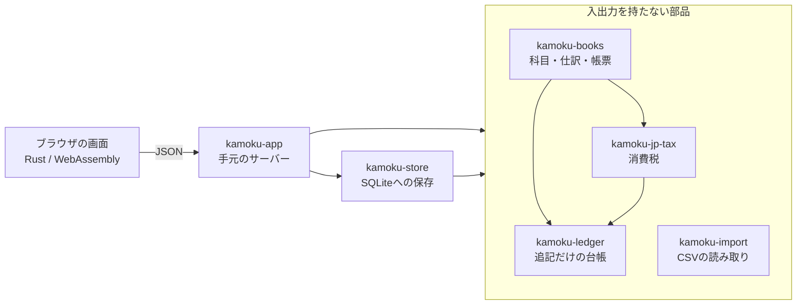

# kamoku（科目）

自分のパソコンの中だけで帳簿をつける、日本の個人事業主のための会計ソフトです。ブラウザで開く画面と、追記だけの台帳を持ち、データはSQLiteのファイル1つに入ります。Rustで作るオープンソースで、いまは **最初のアルファ版（作業中）** です。

[](https://github.com/haranishi/kamoku/actions/workflows/ci.yml)


> **English:** Local-first double-entry bookkeeping for Japanese sole proprietors, written in Rust. First alpha: a small local server plus a browser UI over one SQLite file. No cloud, no bank sync. Documentation is in Japanese.

## 合成データで試す
```
git clone https://github.com/haranishi/kamoku
cd kamoku
rustup target add wasm32-unknown-unknown
cargo install wasm-bindgen-cli --version 0.2.129 --locked
bash tools/build-rust-ui.sh
cargo run -p kamoku-app -- demo
```

ブラウザが開き、架空の事業の2026年の帳簿が見られます。本物の帳簿の置き場所には触りません。Rust 1.88以上、Python 3と、Cのコンパイラ（macOSはXcodeのコマンドラインツール）が要ります。最初のビルドは数分かかります。自分の帳簿をつけるときは `demo` を `serve` に替えます（[使い方](docs/getting-started.md)）。

## 設計で大切にしていること

1. **データは手元に。** SQLiteの普通の表なので、ほかの道具でも読めます。外へ通信しません。
2. **台帳は追記だけ。** 訂正も取消も新しい記録として足し、理由を残します。ハッシュの連鎖で、あとからの書き換えを見つけます（防ぐのではなく、見つけます）。
3. **キーボードだけで記帳できる。** 日本語入力の変換中のEnterで、仕訳を確定しません。
4. **税のルールは、根拠つきの日付表。** 国税庁の資料のURLと確認日を持ち、改正は行を足して対応します。
5. **自動で決めない。** 科目を文字列から推測したり、銀行から自動で取り込んだりはしません。理由は[設計](docs/architecture.md)にあります。

## 機能の状況

| 機能 | 状態 |
|---|---|
| 取引の登録（収入・支出・振替）、家事按分、保存前の仕訳のプレビュー | ✅ |
| 仕訳帳（検索、理由つきの訂正・取消、履歴）、総勘定元帳 | ✅ |
| 明細CSVの取込（UTF-8・Shift_JIS）、未確認の一覧、キーボードでの一括確定 | ✅ |
| ホーム、月次推移、損益計算書、貸借対照表、試算表 | ✅ |
| 消費税の集計（参考値。税理士の確認前） | 🚧 |
| 整合性の検査、末尾のハッシュの控え、バックアップ、CSV・JSONの書き出し | ✅ |
| 証憑の保管、定期的な取引、青色申告決算書の項目への集計、弥生形式 | 📋 予定 |
| 銀行・カードの自動連携、キーワードによる自動仕訳、申告書の作成とe-Tax送信 | 🚫 作りません |

✅は、試験を通した機能です。実際の帳簿で長く使った記録は、まだありません。一覧の全体は[機能の一覧](docs/features.md)にあります。

## 画面

| 取引の登録 | 未確認の確定 |
|---|---|
|  |  |
| **仕訳帳と履歴** | **貸借対照表** |
|  |  |

ほかの画面とスマートフォンの幅の見え方は、[画面の紹介](docs/screens.md)にあります。画像は、すべて合成データです。

## 仕組み


計算の部品は、ファイルも通信も持ちません。保存とサーバーは、外側の2つに閉じ込めてあります。

## 試験と速さ
試験は、Rustの部品とサーバー、画面の単体、本物のサーバーを相手にしたブラウザの通し試験、わざと誤りを入れて試験を確かめる変異試験の層に分けています。どの層が何を確かめ、何を確かめていないかは[試験の地図](docs/testing.md)に書きました。

速さは、台帳の起動時の検証、仕訳の追記、ホームの表示、CSVの取込、画面の操作の5つを測りました。測ったのは1台の Apple M4 Pro だけで、結果と測り方は[速さの測定](docs/benchmarks.md)にあります。

## 文書の地図

- 使う: [使い方](docs/getting-started.md)・[よくある質問](docs/faq.md)・[機能の一覧](docs/features.md)・[画面の紹介](docs/screens.md)
- 参加する: [参加の手引き](CONTRIBUTING.md)・[開発の手引き](docs/development.md)・[最初の貢献の候補](docs/good-first-issues.md)
- 設計の理由: [コンセプト](docs/concept.md)・[設計の判断](docs/architecture.md)・[画面のUX](docs/ux-five-layers.md)・[仕様](docs/spec/stories-record.md)・[ロードマップ](docs/roadmap.md)
- 権利と規約: [権利の確認記録](docs/legal/rights-check.md)・[規約まわりの整理](docs/legal/regulation-notes.md)・[ライセンス方針](docs/legal/license-policy.md)

## 参加する

保守者は1人です。歓迎するのは、不具合や税計算の誤りの報告、合成データのCSVサンプル、用語の指摘、税理士さんによる確認、文書の補足、そして[最初の貢献の候補](docs/good-first-issues.md)にある小さな作業です。返信の目安は1週間です。手順は[参加の手引き](CONTRIBUTING.md)にあります。実際の帳簿・領収書・口座の明細は、Issueにもサンプルにも貼らないでください。

この版は、AIの担当に依頼書を渡して実装させ、別の担当が読み取りでレビューする工程で作りました。工程の記録は[作業記録](.agent-harness/runs/2026-10-14-phase1/README.md)にあります。

## ライセンス・免責・商標

コードは MIT または Apache-2.0（どちらか選べます）、文書と雛形は CC BY 4.0 です。理由は[ライセンス方針](docs/legal/license-policy.md)にあります。

これは税務の助言ではありません。日本文書情報マネジメント協会（JIIMA）の電子帳簿ソフト認証は取っておらず、電子帳簿保存法に「対応済み」とは言いません。自動で出す科目や税区分は参考値です。全文は[DISCLAIMER.md](DISCLAIMER.md)にあります。

freee、マネーフォワード、弥生、Yayoi は各社の商標または登録商標です。本プロジェクトは各社と関係がなく、承認も受けていません。名前は、ファイル形式の互換性の説明と、規約や特許など事実の説明にだけ使います。名前の「kamoku」は、商標の検索（J-PlatPat）が済むまでは変わる可能性があります。
