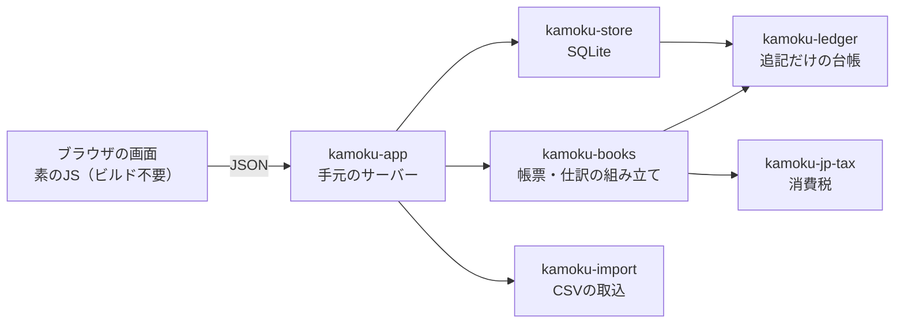

# 設計の判断: 追記だけの台帳、日付つきの税表、手元のWeb画面、通信しない

コードを読めば分かることは書きません。ここに残すのは、なぜその形にしたか、何を捨てたか、どこに限界があるかです。最初の設計案（Driveの資料。AIの生成物と見られる）から変えた点は、「変えた点」と明記します。

## 全体の形

`kamoku-ledger` `kamoku-jp-tax` `kamoku-books` `kamoku-import` は、ファイルや通信を持たない純粋な計算です。保存とサーバーは外側の2つに閉じ込め、計算の部品だけを他のRustプロジェクトからも使えるようにします。

## 画面は、手元のWebサーバーとブラウザにする

起動すると `127.0.0.1` だけで待ち受け、ブラウザで開きます。決めた理由は3つあります。日本語入力の変換は、ブラウザが処理します。画面のファイルにビルドの工程が無く、参加者が編集してすぐ確かめられます。画面の撮影と自動の試験が、簡単に作れます。

**捨てた案**: egui と iced は、Rustだけで画面が作れます。ただ、変換中のEnterや大きな表の扱いを、画面の部品ごとに自分で確かめる必要があり、参加者にも新しい画面の流儀を覚えてもらうことになります。Tauriを最初から使う案は、ビルド環境が重く、参加の入口が狭くなります。画面が固まった後で、同じ画面をTauriで包んで配る道は残します。

**限界**: ブラウザで開くので、同じパソコンの別のプロセスから、待ち受けのポートに届きます。合言葉・Cookie・`Host`と`Origin`の検査で備えますが（[非機能](spec/nfr.md)）、同じ利用者の権限で動く悪意のあるプログラムは防げません。

## 依存を絞る

保存は `rusqlite`（SQLite同梱）、JSONは `serde`、文字コードは `encoding_rs`、合言葉の乱数は `getrandom` です。非同期の実行環境と大きなWebの枠組みは入れません。1人が自分のパソコンで使うので、並行処理の利点より、読み切れる量の方が大切だからです。画面の依存は0で、グラフは自作のSVGです。依存の追加は、`cargo deny` の許可リストを通ったものに限ります。

**HTTPの受け口は、標準ライブラリだけで書いた小さな部分集合です**（`kamoku-app` の中）。最初は小さな同期型の `tiny_http` を選びましたが、最新の0.12は、本文の長さを巨大に宣言した要求を1つ受けるだけで、メモリの確保に失敗してプロセスごと異常終了することを実測しました。読み書きの時間切れも、接続数の上限もありません。`axum` なら防げますが、非同期の実行環境を含めて約50のcrateが入ります。相手はブラウザと試験だけなので、扱う範囲を狭くして（chunked、keep-alive、パイプラインは扱わない）、上限と時間切れを自分で持つ道を選びました。仕訳・取込・帳票の処理は受け口に依存しない関数なので、あとで替えられます。

## 金額は整数の円で持つ

金額は `i64` の円（`Yen`）で持ちます。消費税の端数処理は、1円未満を切捨て・四捨五入・切上げのどれにするかで、場面ごとに使える方法が決まっています。どれも整数の割り算で再現できます。小数型の依存は入れませんでした。SQLiteに10進数の型がなく、変換の誤りが入り込む場所が増えるからです。`f64` は使いません。

## 訂正は追記し、過去の記録は書き換えない

仕訳の登録・訂正・取消は、新しいイベントとして台帳の末尾に足し、SHA-256でつなぎます。訂正は理由が必須で、元の版は残ります。

**変えた点**: 最初の案は、訂正のときに過去のブロックを書き換えてハッシュを再計算していました。これだと後ろの連鎖が壊れます。保存側で更新を禁じる案とも矛盾します。kamokuは過去のイベントに一切触れず、現在の状態をイベントの列から計算します。ハッシュの対象はバイト列の符号化で固定し、文書とゴールデン値の試験で守ります。取引先などの付随情報（`meta`）も、同じ符号化に含めます。

限界は2つあります。連鎖は改ざんを**検知**するだけで、防ぎません。末尾のイベントの削除や、全体を計算し直して作り替えることは、連鎖だけでは見つかりません。末尾のハッシュを画面から写し取って外に控え、後で照合する機能で、この穴を小さくします。電子帳簿保存法の要件を満たすとは言いません。

## 下書きは連鎖の外に置く

CSVから取り込んだ明細は「下書き」の表に入り、自由に直せます。確定した時だけ、台帳へイベントとして追記します。**変えた点**: 最初の案は下書きも確定済みも同じ表に入れ、更新の禁止も付けていました。それでは下書きから確定への移行が更新になり、成り立ちません。

## 税のルールは、根拠つきの日付表にする

税率や経過措置の割合は、コードに書き込まず `kamoku-jp-tax` の表に置きます。各行に、適用期間、割合、国税庁の資料のURL、確認日を付けます。改正があれば行を足し、過去の日付の結果は変えません。税率そのものも、飲食料品を令和9年4月から2年間1%にする案があるため、日付つきの表にするのが次の課題です。集計の画面には、使った表の最終確認日を出します。

## 通信しない

外へは何も送りません。サーバーはHTTPクライアントを持たず、画面はCSPで外部の読み込みを禁じます。AIの提案を入れる場合も、送る項目と送り先を画面に出し、利用者が選んだときにだけ送ります。モデルは同梱しません。

## やらないと決めたこと

| やらないこと | 理由 | 見直す条件 |
|---|---|---|
| 銀行・カードの自動取得 | 銀行法の電子決済等代行業に当たりうる。金融庁は、口座情報を取得して利用者に伝える行為を一般論として該当しうるとし、個別に判断される。保守者1人では責任を持てない | 弁護士か金融庁から、該当しないという見解が得られたとき |
| キーワードによる自動の仕訳と科目の提案 | 自動仕訳に関する他社の特許がある。利用者が決めた既定値は使うが、過去の入力や文字列からの推測は入れない | 弁理士の確認が済んだとき |
| マネーフォワード形式の書き出し | 同社の規約（第13条(14)）が、契約者に、競合・類似するサービスの開発・改良・提供を禁じている。契約者として実機で確かめられない | 規約の確認と法的な見解が得られたとき |
| 申告書の作成とe-Taxの送信 | 保守の負担が大きい。v1の範囲外 | 税理士の協力者が現れたとき |

## 保存はrusqliteを使う

`sqlx` は使いません。個人のパソコンで1人が使うので、非同期もコンパイル時のDB接続も要りません。保存の層は、台帳の連鎖を起動のたびに検証し、壊れていれば読み取り専用で起動します（[データの形](spec/data-model.md)）。
