# 画面の紹介: 何ができる画面か

画像は、すべて `kamoku demo` の合成データです（架空の事業の2026年）。画像は、`e2e/run-real.sh docs-images` で撮り直せます。画面の約束は[画面の仕様](spec/screens-main.md)と[キー操作](spec/keyboard.md)にあります。

## ホーム

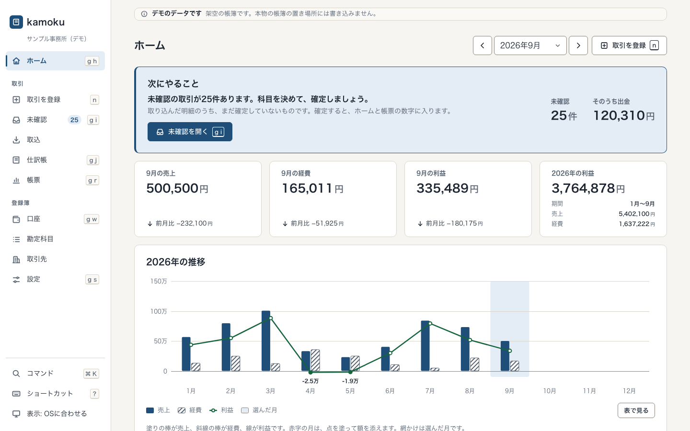

「次にやること」に、未確認の取引の件数が出ます。月ごとの売上・経費・利益と、1年の推移のグラフがあります。グラフは「表で見る」で、同じ数字の表にも切り替えられます。左のサイドバーの項目の横にある小さな枠は、キーボードのショートカットです（`g` のあとに `h` で、ホームへ）。1文字のショートカットは、押し間違いで画面が移ることがあるので、`?` で開く一覧の先頭のチェックで切れます。

## 取引を登録

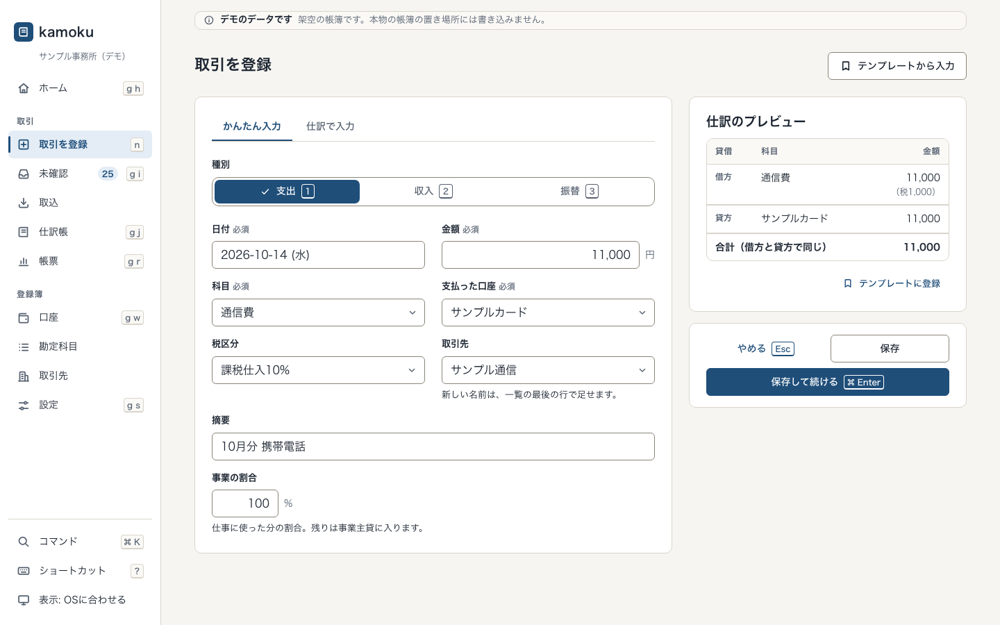

金額、科目、支払った口座を入れます。保存の前に、右のプレビューで、借方と貸方の仕訳を確かめられます。事業の割合が100未満なら、残りは「事業主貸」に入ります（家事按分）。「仕訳で入力」に切り替えると、借方と貸方を自分で組めます。

## 未確認の確定

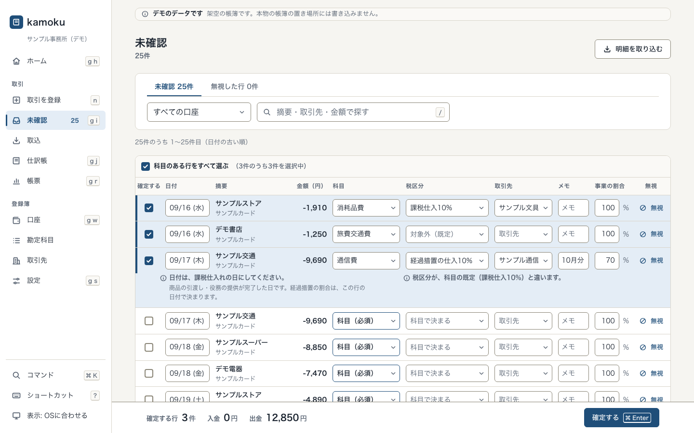

取り込んだ明細が並びます。科目を選んで Enter を押すと次の行へ進み、選んだ行が「確定する行」になります。下のバーで件数と金額を見て、Ctrl+Enter（macOSは Cmd+Enter）でまとめて確定します。科目が空の行は、確定する行になりません。確定した仕訳は、あとから理由つきで訂正・取消できます。

## 明細のCSVを取り込む

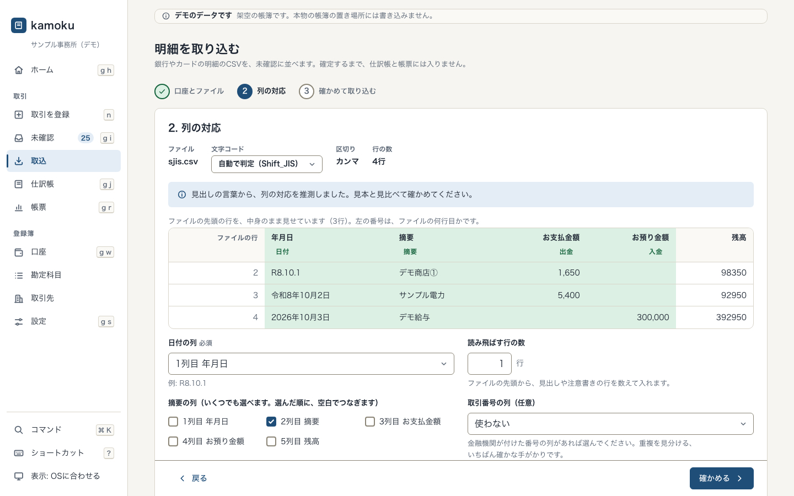

取込は3段階です。口座とファイルを選び、列の対応を決め、「新規」「重複」「読めない」の件数を確かめて取り込みます。列の対応は、見出しの言葉から推測し、口座ごとに覚えます。文字コードは、自動で判定し、手で選び直せます。

## 仕訳帳と履歴

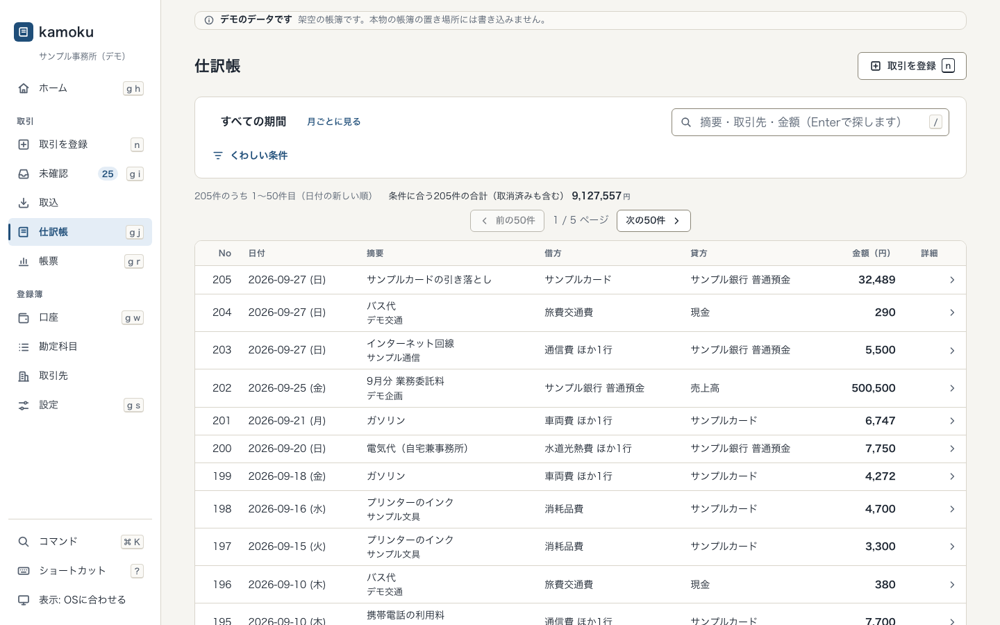

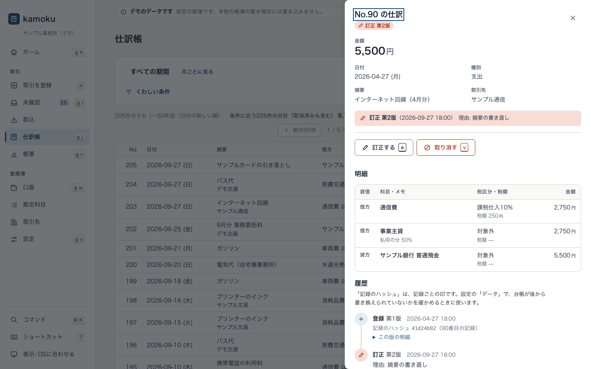

仕訳を検索して、1件を開くと、明細と履歴が出ます。訂正と取消は、理由を書いて新しい記録として足します。元の記録は消えず、履歴に残ります。

## 帳票

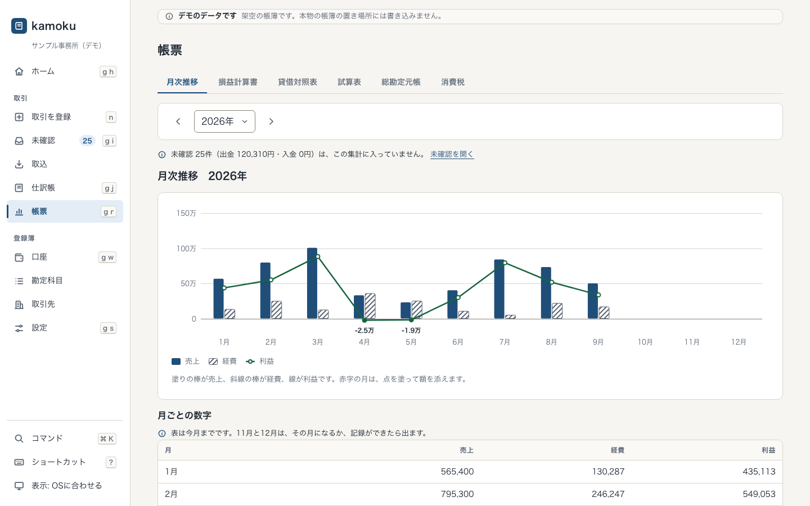

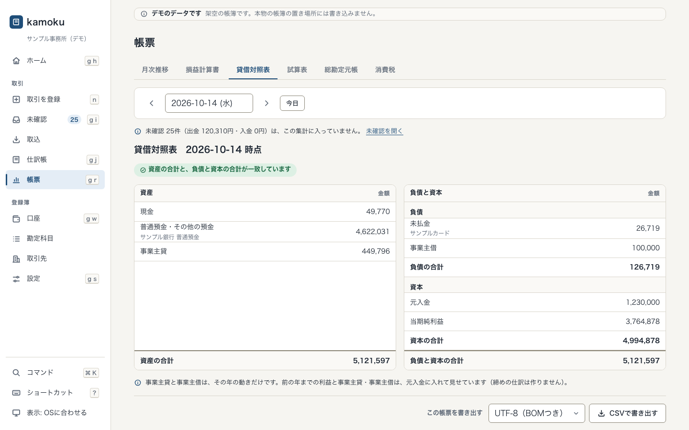

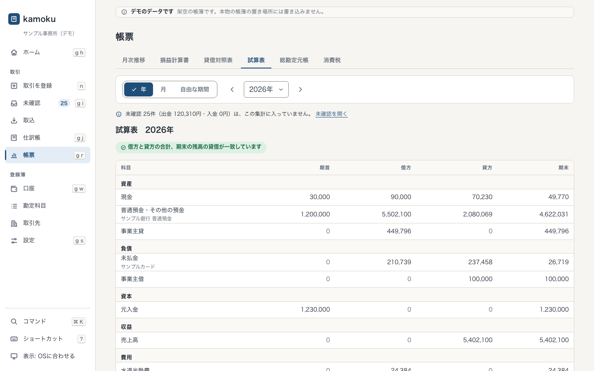

月次推移、損益計算書、貸借対照表、試算表、総勘定元帳、消費税の集計の6つです。消費税の集計は参考値で、税理士の確認前です。どの帳票も、CSVで書き出せます（UTF-8のBOMつきか、Shift_JIS）。

## 設定

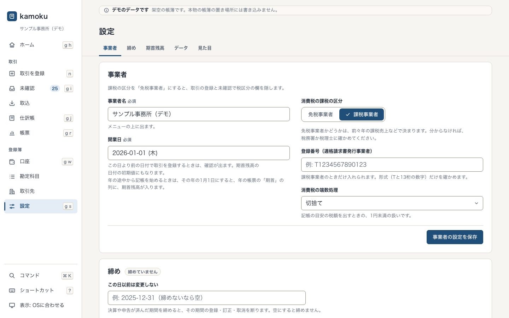

事業者の名前と課税の区分、仕訳を直せなくする「締め」の日、期首残高、台帳の検査とバックアップ、ライト・ダークの切り替えがあります。

## ダークとスマートフォンの幅

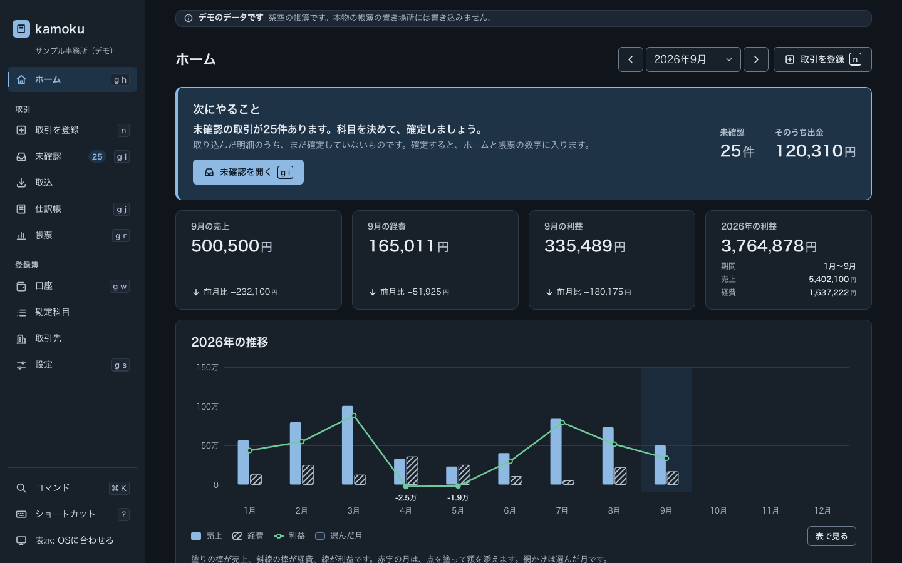

ライトとダークは、OSの設定に従い、手動でも切り替えられます。幅390pxでは、サイドバーが下のバーに替わります。

| ホーム | 取引を登録 | 未確認 |
|---|---|---|
| 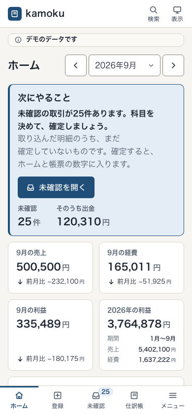 | 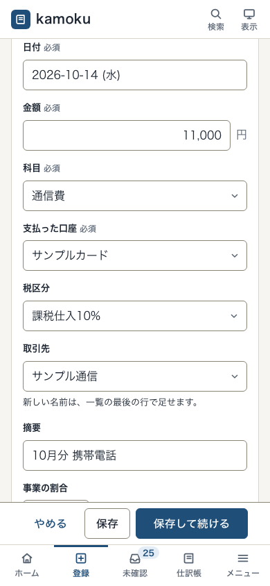 | 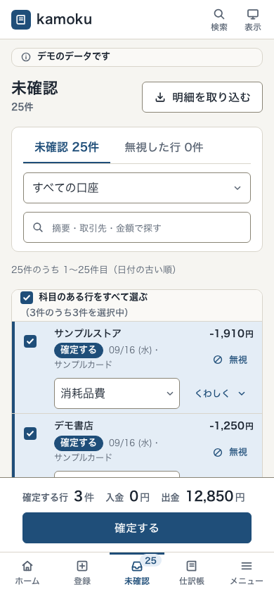 |
